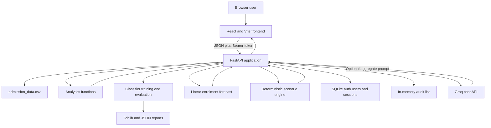
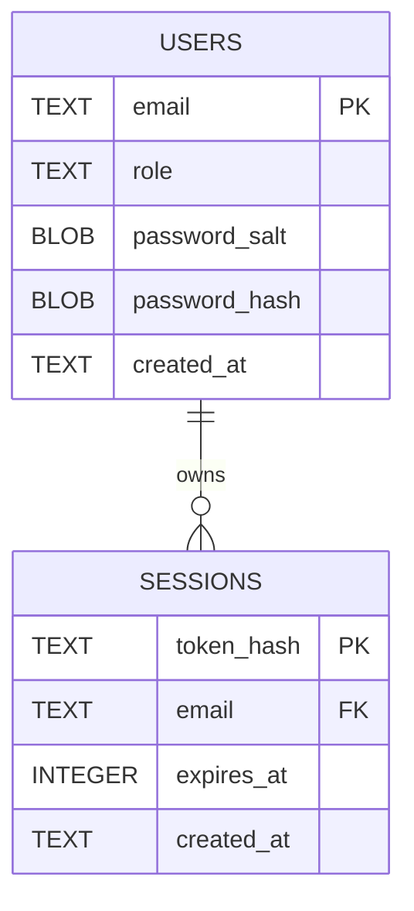
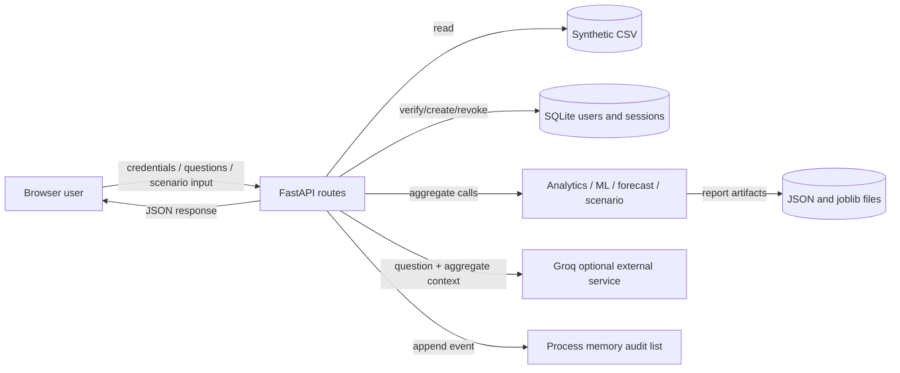
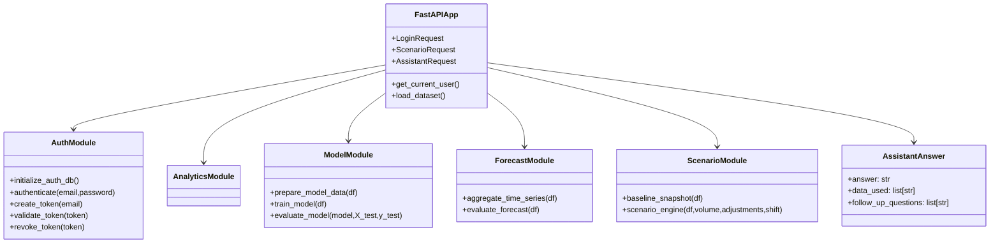
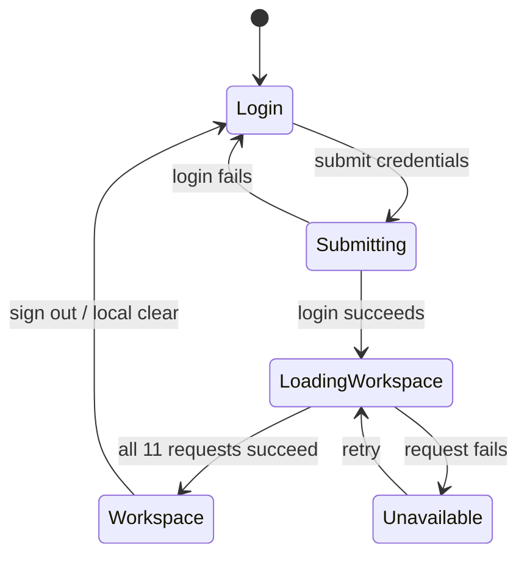
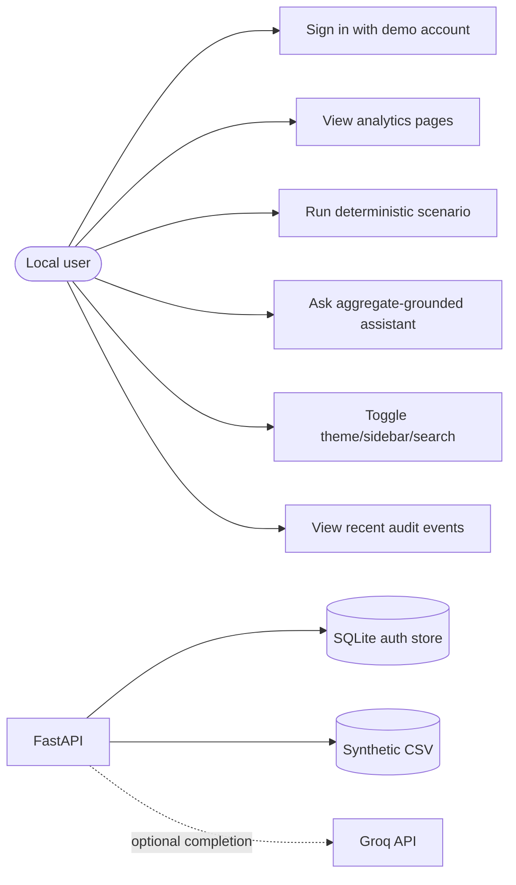
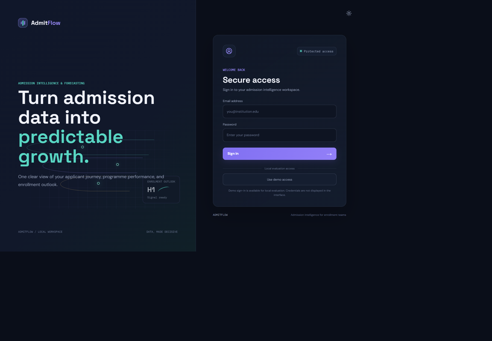
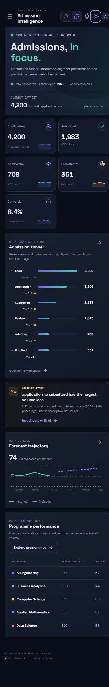
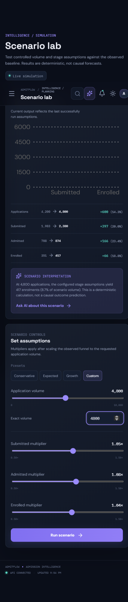
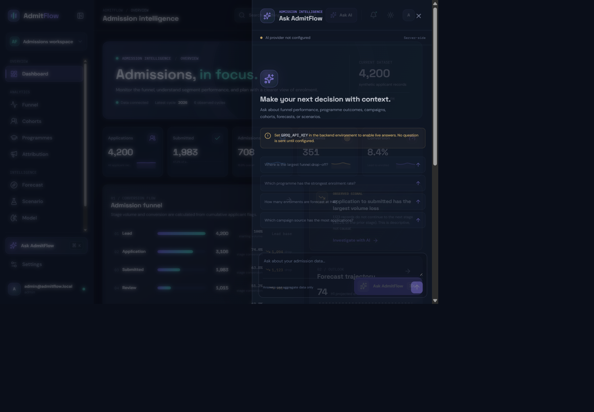

# PROJECT REPORT

## ADMITFLOW

### “Admission Conversion Forecasting with Funnel Attribution and Scenario Simulation”

**Submitted in partial fulfilment of the requirements for**  
**T.Y. B.Sc. Data Science**  
**BDS-03 Capstone Project**

**Submitted by**  
Samiksha  
Zahir

**College:** KES' Shroff College  
**Academic Year:** 2026–27  
**Project Guide:** [TO BE PROVIDED]  
**PRN / Roll numbers / Division / Semester:** [TO BE PROVIDED OR CONFIRMED]

[Insert the college-approved logo, official institute name, and cover-page layout from the faculty template.]

---

# CERTIFICATE

This is to certify that **Samiksha** and **Zahir**, students of T.Y. B.Sc. Data Science, have completed the project titled **“Admission Conversion Forecasting with Funnel Attribution and Scenario Simulation”** as part of the BDS-03 Capstone Project for Academic Year 2026–27, subject to verification and approval by the college and project guide.

**Project Guide:** [Name and signature]  
**Teacher In-charge / Coordinator:** [Name and signature]  
**Principal:** [Name and signature]  
**Date:** [TO BE COMPLETED BY COLLEGE]

> This is a draft certificate page, not an official certification. Confirm the institute's exact legal name and required certificate wording with faculty before submission.

---

# PROFORMA FOR APPROVAL OF PROJECT PROPOSAL

**PRN No(s).:** [TO BE PROVIDED]  
**Roll No(s).:** [TO BE PROVIDED]

1. **Name(s) of student(s):** Samiksha and Zahir
2. **Title of project:** Admission Conversion Forecasting with Funnel Attribution and Scenario Simulation
3. **Name of guide:** [TO BE PROVIDED]

| Student signature(s) | Project guide signature | Coordinator signature |
|---|---|---|
| [Pending] | [Pending] | [Pending] |
| **Date:** [Pending] | **Date:** [Pending] | **Date:** [Pending] |

---

# ABSTRACT

AdmitFlow is a local admission analytics and decision-support prototype developed for the BDS-03 Data Science capstone. It uses a reproducibly generated synthetic dataset of 4,200 applicant records across six admission cycles, 2021–2026. The project calculates a cumulative admission funnel, compares outcomes across cycles and applicant groups, reports descriptive campaign-source associations, evaluates two classifiers for the synthetic `enrolled` outcome, extrapolates annual enrolments using linear regression, and calculates deterministic what-if scenarios. A React interface presents these outputs through a FastAPI backend. An optional server-side Groq integration answers natural-language questions using aggregate context computed by the API.

The funnel contains 4,200 leads, 3,106 application starts, 1,983 submissions, 1,015 reviews, 708 admissions/offers, and 351 enrolments. Logistic regression and random forest are compared on a stratified random 75/25 split; reported ROC-AUC values are 0.5573 and 0.5195 respectively. The random forest predicts no positive cases at the default threshold, so its 91.62% accuracy does not demonstrate useful detection. Forecasting uses six annual observations, fits on the first four, and evaluates on the last two; its H1/H2/H4/H6 values are 74.2, 77.3, 83.5, and 89.7 enrolments. Scenario outputs are calculated from user-provided multipliers and are not causal predictions. Campaign attribution is descriptive and does not establish campaign impact.

The project demonstrates a traceable analytics workflow, but its synthetic data, weak classifier results, short forecast history, deterministic scenario assumptions, demo-only identity flow, and process-local audit log prevent operational admissions use.

**Keywords:** synthetic data, admission funnel, classification, forecasting, descriptive attribution, scenario simulation, FastAPI, React, SQLite.

---

# ACKNOWLEDGEMENT

[Students: personalize this page. The repository does not identify a guide, faculty member, participant, or other person whose contribution can be acknowledged. Do not retain names from the faculty sample unless they apply to this project.]

We would like to thank [project guide] and [faculty/department] for their guidance and feedback during the development of this project. We also acknowledge the maintainers of the open-source tools used in the implementation, including Python, FastAPI, pandas, NumPy, scikit-learn, React, Vite, and Recharts. We are grateful to our families and peers for their support.

**Samiksha**  
**Zahir**

---

# DECLARATION

[Students must review and sign this declaration according to the college's prescribed wording.]

We, **Samiksha** and **Zahir**, declare that this project report, titled **“Admission Conversion Forecasting with Funnel Attribution and Scenario Simulation,”** is submitted by us in partial fulfilment of the requirements for the T.Y. B.Sc. Data Science BDS-03 Capstone Project for Academic Year 2026–27. The report must be reviewed to ensure that all descriptions, references, individual contributions, and declarations of assistance are accurate before signing.

| Student | Signature | Date |
|---|---|---|
| Samiksha | [Pending] | [Pending] |
| Zahir | [Pending] | [Pending] |

---

# TABLE OF CONTENTS

Page numbers should be generated after the report is transferred into the college's final page layout.

1. Chapter 1 — Introduction
   1.1 Significance
   1.2 Objectives
   1.3 Purpose and Scope
   1.3.1 Purpose
   1.3.2 Scope
   1.4 Applicability
   1.5 Achievements
2. Chapter 2 — System Analysis
   2.1 Existing System and Problem Context
   2.2 Proposed System
   2.3 Requirements Analysis
   2.4 Hardware Requirements
   2.5 Software Requirements
   2.6 Survey of Technology
3. Chapter 3 — System Design
   3.1 Module Division
   3.2 Project Schedule / Gantt Chart
   3.3 E-R Diagram
   3.4 Data Flow Representation
   3.4.1 Data Flow Diagram
   3.5 UML / Component Diagrams
4. Chapter 4 — Implementation and Testing
   4.1 Implementation
   4.2 Testing Approach
   4.3 Test Cases
   4.4 Failure, Security and Robustness Testing
5. Chapter 5 — Results and Discussions
   5.1 Functionality Evaluation
   5.2 User Experience Assessment
   5.3 Machine Learning and Forecasting Results
   5.4 Funnel and Attribution Results
   5.5 Scenario Simulation Results
   5.6 Data Quality Results
   5.7 Defect and Discrepancy Summary
6. Chapter 6 — Conclusion and Future Work
   6.1 Conclusion
   6.2 Future Scope
   6.3 Limitations
7. Chapter 7 — References

---

# CHAPTER 1 — INTRODUCTION

## 1.1 Significance

Admissions teams may need to understand how applicant counts change across stages, how outcomes differ across cycles and groups, and how explicit planning assumptions affect projected counts. A raw table does not automatically provide these summaries. AdmitFlow brings selected aggregate calculations, model evaluation, a simple forecast, and deterministic scenario arithmetic into a local application.

The academic significance is the integration of data generation, validation, group aggregation, classification, forecast evaluation, API design, and visualization. The result is a demonstration of an analytical workflow, not proof that its synthetic metrics represent a real institution. The application intentionally distinguishes descriptive observations from causal claims.

**Project sources:** `docs/PROJECT_SPEC.md`; `backend/admitflow/analytics.py`; `backend/admitflow/ml.py`; `backend/admitflow/forecast.py`; `backend/admitflow/scenario.py`.

## 1.2 Objectives

1. Generate a repeatable synthetic admissions dataset using a fixed seed.
2. Validate selected data-quality properties and record a validation report.
3. Calculate cumulative funnel volumes, stage conversion, and drop-offs.
4. Compare outcomes by cycle, programme, region, selectivity, and campaign source.
5. Report campaign-source distributions and rates descriptively, without claiming causality.
6. Train and compare logistic regression and random forest classifiers for `enrolled`.
7. Produce an annual linear-trend forecast with holdout error metrics and H1/H2/H4/H6 horizons.
8. Calculate reproducible what-if scenarios from a requested application volume and stage multipliers.
9. Serve the results through protected FastAPI routes and display them in a React interface.
10. Provide an optional Groq-based assistant that receives aggregates computed by the API.

These objectives are based on the project specification and current source. “Train/evaluate a model” does not mean that a suitable admissions model was achieved; the saved results show weak discrimination.

## 1.3 Purpose and Scope

### 1.3.1 Purpose

The purpose is to demonstrate how an admission analytics workflow can turn synthetic applicant rows into readable aggregate summaries, exploratory model results, directional projections, and assumption-driven scenarios. The intended outcome is an inspectable local prototype for academic evaluation.

### 1.3.2 Scope

The application reads `data/admission_data.csv`; it does not ingest real institutional records or expose an applicant record-management workflow. Analytics and modelling are calculated on the backend. The browser provides the dashboard, analytics pages, settings, navigation, and optional assistant. SQLite persists the seeded demo user and authentication sessions only; analytics data remains in CSV. Audit events are held in memory.

The current application does not implement registration, password recovery, OAuth sign-in, per-applicant scoring, causal campaign attribution, live institutional data synchronization, or a production deployment configuration.

## 1.4 Applicability

The project can be demonstrated by a student or evaluator using the supplied synthetic dataset and local development servers. Admissions or enrolment teams are the intended audience in project materials, but actual institutional adoption, stakeholder validation, legal review, or operational suitability is **not verified**.

## 1.5 Achievements

- Generated dataset: 4,200 rows and 22 columns, seed 42.
- Validation report: zero missing cells, duplicate IDs, invalid dates, and listed category issues.
- Calculated funnel, cycle, cohort, programme, and source summaries.
- Implemented classifier and forecast pipelines with saved reports/artifacts.
- Added deterministic scenario calculations with monotonic count clamping.
- Implemented FastAPI routes and bearer-protected analytics paths.
- Added local SQLite-backed demo authentication and session revocation.
- Implemented React dashboard and analytics workspaces, responsive styling, and an optional Groq assistant.
- Saved evidence JSON, joblib artifacts, screenshots, and test/build logs.

The saved tracker marks 17 tasks complete, but that status does not override documented quality limitations. See Chapter 5 for test-count discrepancies and model results.

---

# CHAPTER 2 — SYSTEM ANALYSIS

## 2.1 Existing System and Problem Context

The project specification frames the problem as difficulty identifying stage-level volume changes, segment differences, and possible planning outcomes from admissions records. The repository contains no comparative study of a named existing institution system or competitor. Therefore, do not present generalized claims such as “all existing systems are inefficient” as measured findings. A literature-based existing-system comparison needs independently collected sources.

The implemented dataset is synthetic, so AdmitFlow demonstrates calculations and software flow rather than replacing a college admission platform.

## 2.2 Proposed System

The proposed system consists of a React single-page interface calling JSON endpoints on FastAPI. The API reads the CSV and calls analytics, classification, forecast, scenario, authentication, or assistant modules. SQLite is used only for local account/session persistence. Optional AI requests send selected aggregates to Groq. JSON and joblib evidence files are stored under `evidence/` and `data/`.



## 2.3 Requirements Analysis

### Functional requirements reflected in the current app

- Authenticate with the seeded local demo account and send a bearer token.
- View dashboard totals, a cumulative funnel, cohorts, programme outcomes, source associations, forecast, model metrics, and audit events.
- Submit a scenario with application volume and stage multipliers.
- Optionally submit an assistant question and scenario context to the backend.
- Toggle theme/sidebar and use the client-side command palette.

### Requirements not implemented

Registration, password resets, role administration, OAuth provider sign-in, applicant CRUD, applicant-level prediction, durable audit history, campaign-effect estimation, real data ingestion, and institutional deployment are not implemented.

### Non-functional behavior verified from source

The frontend has responsive CSS breakpoints, loading/error/empty states in selected areas, reduced-motion CSS, focus-visible styles, and a small set of ARIA labels/roles. No formal usability, WCAG conformance, load, latency, or security penetration study is in the repository.

## 2.4 Hardware Requirements

The repository does not establish minimum or recommended hardware requirements. The development workspace is Windows with Python 3.10.11 and Node.js 22.23.1, but these observed versions are not a benchmark or minimum specification. **Hardware requirements: NOT VERIFIED / NEEDS INPUT.** Do not copy the faculty sample’s game-server specifications.

## 2.5 Software Requirements

Observed current environment and lockfile versions (environment snapshot dated 2026-10-03): Python 3.10.11; FastAPI 0.142.2; Uvicorn 0.54.0; pandas 2.3.3; NumPy 2.2.6; scikit-learn 1.7.2; joblib 1.6.0; python-dotenv 1.2.4; Groq 1.7.0; pytest 9.1.1; React/React DOM 19.3.0; Vite 8.3.2; Recharts 3.10.1; Lucide React 1.50.0; Vitest 5.0.3; Oxlint 1.86.0; Node.js 22.23.1.

`backend/requirements.txt` uses lower bounds, not exact pins. Frontend versions are resolved in `frontend/package-lock.json`. Python package versions can vary when reinstalled. PyJWT remains in requirements but is not used by current `auth.py`.

## 2.6 Survey of Technology

| Technology | Actual role in AdmitFlow | Evidence-based explanation |
|---|---|---|
| Python | Backend language and scripts | Source modules and scripts are Python. |
| FastAPI/Uvicorn | API/application server | Route decorators, dependency auth, local ASGI serving. |
| pandas/NumPy | Tabular grouping and numeric generation/calculation | CSV processing, aggregation, random generation, year index. |
| scikit-learn | Classifiers, preprocessing, metrics, linear forecast | Actual estimators and transformers in `ml.py`/`forecast.py`. |
| SQLite (`sqlite3`) | Local auth persistence | `users` and `sessions` tables; not an analytics warehouse. |
| React/Vite | Browser SPA and dev/build tooling | `App.jsx`, Vite config and package scripts. |
| Recharts | Frontend charts | Used in `WorkspacePages.jsx`. |
| Groq SDK | Optional external LLM call | `assistant.py`; aggregates are passed by the API. |
| Vitest/Testing Library/pytest | Tests | Current frontend and backend test suites. |

A comparative technology-selection study is not present. Explain direct project use; do not claim the team benchmarked alternatives unless separate evidence is supplied.

---

# CHAPTER 3 — SYSTEM DESIGN

## 3.1 Module Division

| Module | Main responsibilities | Main source files |
|---|---|---|
| Dataset generation/validation | Generate CSV and report selected checks | `backend/admitflow/data_generator.py`, `scripts/generate_dataset.py` |
| Analytics | Dashboard, funnel, cycle, cohorts, programme, region, selectivity, attribution | `backend/admitflow/analytics.py` |
| ML | Feature selection, preprocessing, classifier training/evaluation, joblib save | `backend/admitflow/ml.py` |
| Forecast | Annual aggregation, linear fit, holdout metrics, future horizons | `backend/admitflow/forecast.py` |
| Scenario | Scale baseline, multiply, clamp, report deltas | `backend/admitflow/scenario.py` |
| Auth/database | SQLite user/session schema, password/token verification | `backend/admitflow/auth.py`, `config.py` |
| AI | Groq request, prompt, JSON validation, provider errors | `backend/admitflow/assistant.py` |
| API | Routes, request schemas, CORS, authentication dependency, audit list | `backend/admitflow/server.py` |
| Frontend | Page state, API calls, navigation and overlays | `frontend/src/App.jsx`, `components/`, `pages/` |
| Evidence/tracker | Reports, tests/evidence capture and tracker | `scripts/`, `evidence/`, `TRACKER.xlsx` |

## 3.2 Project Schedule / Gantt Chart

`TRACKER.xlsx` contains 17 tasks, 121 planned hours and all tasks marked “Completed.” It records zero actual hours and no task completion dates; its Work Log has one closeout row dated 2026-10-02. Therefore, the repository supports a **planned task-hours summary**, but not an evidence-backed dated Gantt chart. Insert a real timeline only after Samiksha/Zahir provide task start/end dates and actual work periods. The phase order in `docs/DEVELOPMENT_PLAN.md` is a plan, not a dated schedule.

## 3.3 E-R Diagram

The actual database is `data/admitflow_auth.sqlite3`, containing only `users` and `sessions`. Applicant analytics are not stored in this database; they are read from CSV. There is no audit table, leaderboard table, match entity, or model table.



`users.email` is primary key. `sessions.token_hash` is primary key. `sessions.email` references `users.email` with `ON DELETE CASCADE`. Only implicit primary-key indexes exist. SQLAlchemy/ORM and migrations are not present.

## 3.4 Data Flow Representation

### 3.4.1 Data Flow Diagram



No Firebase, server-managed analytics database, chat database, or separate matchmaking service exists in this project.

## 3.5 UML / Component Diagrams

These diagrams describe actual application components and flows; they are not generated from UML classes in the codebase.

### 3.5.1 Component/Class View



These are actual modules/functions/schemas, not an assertion that `Player`, `Match`, `FirebaseDB`, or other faculty-sample classes exist.

### 3.5.2 Sequence Diagram — Login and Protected Request

```mermaid
sequenceDiagram
    actor User
    participant UI as React App
    participant API as FastAPI
    participant DB as SQLite
    User->>UI: Submit email/password
    UI->>API: POST /auth/login
    API->>DB: Lookup user; verify PBKDF2 hash
    API->>DB: Store SHA-256 hash of random token + expiry
    API-->>UI: Return bearer token and user
    UI->>UI: Store token/user in localStorage
    UI->>API: GET /api/dashboard with Bearer token
    API->>DB: Validate token hash and expiry
    API->>API: Read CSV and compute dashboard metrics
    API-->>UI: JSON metrics
    UI-->>User: Render page
```

### 3.5.3 State Chart — Frontend Authentication/Load States



This is a report-level representation derived from `App.jsx`; no formal state-machine library or backend auth state chart exists. A 401 on workspace loading does not automatically clear the saved token.

### 3.5.4 Use-Case Diagram



Use cases such as registration, password reset, administrator management, leaderboard, or applicant scoring must not be added; they are not implemented.

---

# CHAPTER 4 — IMPLEMENTATION AND TESTING

## 4.1 Implementation

### Frontend implementation

React 19 and Vite implement a single-page app. `App.jsx` selects pages using local state, retrieves eleven API responses concurrently after login, stores them in React state, and uses localStorage for bearer token/user and selected UI preferences. `fetchJson()` attaches the bearer header and JSON content type. Recharts draws bar/area/line charts; the funnel itself is custom HTML/CSS. The command palette is client-side substring filtering over already loaded data.

### Backend implementation

FastAPI routes are declared in `backend/admitflow/server.py`. `load_dataset()` calls `pd.read_csv(DATASET_PATH)`. Analytics, ML, forecast, scenario and assistant logic live in separate modules. Pydantic validates login/scenario/assistant request shapes; analytics outputs are dictionaries/lists rather than explicit response model classes.

### Machine-learning implementation

`ml.py` selects the 12 stated features and `enrolled` target. A `ColumnTransformer` applies numeric median imputation and categorical most-frequent imputation plus one-hot encoding. A stratified random 75/25 split with seed 42 is used. Pipelines fit balanced logistic regression and a 200-tree random forest (`min_samples_leaf=2`). `joblib.dump()` saves both estimators; `/api/model` retrains and reports metrics. There is no `joblib.load()` or endpoint for new-applicant scoring.

### Forecast implementation

`forecast.py` aggregates annual applications, admissions and enrolments. It fits `LinearRegression` to enrolments versus year index; first four years train, last two are holdout. The future values reuse that four-year model. The response currently labels `training_years` as six (total observations), not actual fit size.

### Scenario implementation

Scenario engine scales current baseline counts to requested volume, applies the three stage multipliers, rounds, clamps to maintain a monotonic funnel, calculates rates/deltas/percentage changes and returns `deterministic: true`. `campaign_shift` is returned but does not alter the calculated counts.

### AI implementation

`assistant.py` reads `GROQ_API_KEY` and uses Groq chat completion with default model string `openai/gpt-oss-120b`. API computes aggregate context, optionally recomputes scenario, and submits it with the question. The prompt asks for grounded JSON and response is checked by `AssistantAnswer`. There is no RAG, vector store, streaming, applicant-row submission, local model, or AI classifier. Missing key/SDK returns 503; provider/malformed result returns 502.

### Database/auth implementation

SQLite contains only `users` and `sessions`. Passwords are stored as salted PBKDF2-HMAC-SHA256 hashes (310,000 iterations; 16-byte random salt); random bearer token hashes (SHA-256) and eight-hour expiry are stored for sessions. Logout deletes the session row. One seeded demo account exists; there is no registration screen/API. Audit events are in memory, not in SQLite.

## 4.2 Testing Approach

Available automated tests: pytest in `tests/`; Vitest, jsdom and Testing Library in `frontend/src/App.test.jsx`. Tests cover analytics, API/auth, assistant fallback/mock context, SQLite auth persistence/revocation, data validation, ML result shape, scenario logic, CORS/security and selected UI interactions. Frontend calls are mocked; they are not end-to-end browser tests against a live service.

Evidence files report backend **20 passed**, frontend **3 passed**, lint clean, build successful with a >500 kB JS chunk warning. Current source contains 21 backend test functions due the newer SQLite test; a later known run returned 21 passes, but the checked-in log was not synchronized. The report must disclose both records and refresh evidence before final submission.

## 4.3 Test Cases

| Test ID | Feature / source test | Input and expected result | Recorded outcome |
|---|---|---|---|
| B01 | Funnel shape/order | Current CSV; stages ordered, monotonic, JSON-safe | Pass in known run |
| B02 | Cycle grouping | Current CSV; cycle column and rows | Pass |
| B03 | Health API | GET `/health`; 200/ok | Pass |
| B04 | Protected route | GET `/api/dashboard` without token; 401 | Pass |
| B05 | CORS | OPTIONS from localhost:5173; allow origin, no credentials | Pass |
| B06 | Assistant unconfigured | Remove key; status false and assistant 503 | Pass |
| B07 | Assistant scenario context | Mock Groq; scenario aggregates appear in prompt | Pass |
| B08 | API workflow | Demo login then dashboard/funnel/cohort/programme/attribution/forecast/scenario/audit/logout | Pass |
| B09 | Invalid login | Bad email/password; 401 | Pass |
| B10 | Assistant missing key | `ask_admitflow`; HTTP 503 | Pass |
| B11 | Assistant mocked response | Valid mocked JSON; typed answer returned | Pass |
| B12 | Auth success | Demo credentials; token returned | Pass |
| B13 | Auth persistence/security | Temporary DB; stored hashes; validation after DB reinit; revoke invalidates token | Pass |
| B14 | Auth invalid user | Unknown account; `ValueError` | Pass |
| B15 | Data validation | Current CSV; valid, no ID duplicates/date errors | Pass |
| B16 | ML output contract | Train both models; metric keys and 10 top signals | Pass |
| B17 | Scenario schema | 5,200 applications; expected keys and deterministic flag | Pass |
| B18 | Scenario proportional scale | 2× applications; monotonic doubled counts | Pass |
| B19 | Negative scenario | Volume −1; `ValueError` | Pass |
| B20 | Token round-trip | Demo token; expected `sub` and role | Pass |
| B21 | Wrong password | Reject invalid password | Pass |
| F01 | Login UI | Render app; login card visible | Frontend suite pass |
| F02 | Theme | Click theme switch; label changes | Frontend suite pass |
| F03 | UI/API interaction | Mocked fetch; token header, cohorts, attribution, scenario, offline assistant, palette | Frontend suite pass |

Test IDs B01–B21/F01–F03 are labels for this report; the test source files use function names rather than those IDs. No dedicated forecast unit test, actual load test, production security audit or user survey was found.

## 4.4 Failure / Security / Robustness Testing

Verified tests exercise missing bearer token (401), wrong login, missing AI key (503), mocked assistant response/context, negative scenario volume and session revocation. Auth queries use bound SQLite parameters, foreign keys are enabled, and CORS is restricted to the two local frontend origins with credentials disabled. Password/session hashes are stored, not plaintext password/token.

Not evidenced: brute-force testing, rate limiting, MFA, penetration testing, SQL injection test suite, load/latency benchmarks, persistent audit, TLS/reverse proxy, live Groq evaluation suite, or formal backup/recovery. Do not repeat the faculty sample's security claims as AdmitFlow results.

---

# CHAPTER 5 — RESULTS AND DISCUSSIONS

## 5.1 Functionality Evaluation

The API smoke report records health 200, login 200, unauthenticated dashboard 401 and successful protected routes/scenario operations. Frontend evidence shows login, dashboard, funnel analytics, programme/cohort/source/forecast/scenario/model/audit/assistant interfaces, and settings for theme, sidebar, and provider status. Functional evidence is local and synthetic-data-based.

## 5.2 User Experience Assessment

The UI implements responsive layouts, dark/light theme, navigation, loading/error states, dialogs, charts, keyboard palette and accessible labels/focus styles in selected controls. No formal participant study, questionnaire, usability score, or accessibility audit exists. Therefore no measured “user satisfaction” or UX improvement claim is supportable.

## 5.3 ML / Forecasting Results

Classifier metrics:

| Model | ROC-AUC | PR-AUC | Accuracy | Precision | Recall | F1 | Log loss |
|---|---:|---:|---:|---:|---:|---:|---:|
| Logistic Regression | .5573 | .0964 | .6143 | .1028 | .4659 | .1684 | .6611 |
| Random Forest | .5195 | .1037 | .9162 | 0 | 0 | 0 | .2975 |

Forest predicts all records negative: confusion matrix `[[962,0],[88,0]]`. The high accuracy is class imbalance, not useful positive detection. Neither estimator is appropriate for admissions decisions.

Forecast H1/H2/H4/H6: 74.2 / 77.3 / 83.5 / 89.7. MAE 14.55; RMSE 15.5726; MAPE 27.33%, evaluated on two held-out years. Forecast is illustrative, not operational.

## 5.4 Funnel / Attribution Results

Funnel: 4,200 → 3,106 → 1,983 → 1,015 → 708 → 351; overall 8.36%. Largest absolute reduction: 1,123 between application-start and submitted. This says where volume changes, not why.

Partner is the largest source by row count: 749 (17.83% share). Social has highest observed enrolment rate: 65/674 = 9.64%. The source comparisons are descriptive and do not prove campaign effects.

## 5.5 Scenario Simulation Results

Default Expected API scenario: baseline 4,200/1,983/708/351; scenario 5,000/2,479/910/435; enrolment delta +84 (+23.93%). These are outputs of stated volume/multiplier arithmetic, not a learned or causal forecast. The current scenario report includes campaign-shift values but does not use them to modify counts.

## 5.6 Data Quality Results

Dataset report: 4,200 rows, 22 columns, no missing values, no duplicate applicant IDs, no invalid dates/categories reported. The validation routine is partial; its stage-order block does nothing and it does not comprehensively check flag consistency. The data is synthetic.

## 5.7 Defect / Discrepancy Summary

- Forecast field `training_years=6` but fit uses four annual points and holds out two.
- `campaign_shift` accepted and returned but does not affect scenario arithmetic.
- `dashboard-redesign.png` actually captures the assistant/offline overlay; do not caption it as a clean dashboard.
- `dashboard-dark.png` is visually blurred/obscured; not suitable for legible metric evidence.
- Saved pytest log says 20 passes while current source has 21 backend test functions and a known later run reported 21 passed.
- README and some final-verification prose still refer to old JWT signing behavior; current auth uses SQLite sessions.
- No formal defect log exists. These are implementation/documentation/evidence discrepancies, not a claim that they are all fixed defects.

### Selected Interface Evidence

**Figure 5.1. Login screen**



**Figure 5.2. Responsive mobile dashboard**



**Figure 5.3. Scenario Lab at the captured 4,800-application state**



**Figure 5.4. Assistant unavailable state**



---

# CHAPTER 6 — CONCLUSION AND FUTURE WORK

## 6.1 Conclusion

AdmitFlow combines synthetic dataset generation and validation, descriptive admission analytics, exploratory classifiers, a linear annual enrolment forecast, deterministic scenario calculations, a FastAPI service, SQLite-backed local demo authentication, and a React interface. It demonstrates how those pieces can be connected and how outputs can be inspected in one local workspace.

The results do not establish real-world admissions performance. Classifier discrimination is weak, the random forest detects no positive holdout cases at its default threshold, the forecast is based on a short history, attribution is non-causal, and scenario outputs are assumption-based. The project should be described as an academic prototype, not production-ready admissions decision software.

## 6.2 Future Scope

Future improvements, not current features:

- Obtain permissioned, representative institutional data with defined outcome semantics and privacy review.
- Expand validation for binary/nested flags, stage agreement, cycle/date consistency, schema and duplicate rows.
- Use temporal and external evaluation, repeated splits, calibration, threshold/cost analysis and subgroup checks for classifiers.
- Correct forecast fit-count reporting, compare naïve baselines, refit on full history after evaluation, add cycles and uncertainty intervals.
- Implement causal attribution only with a defensible experiment or quasi-experimental design.
- Define campaign-shift semantics and incorporate them only if supported by measured estimates.
- Add account registration/recovery, roles, rate limiting, improved token transport/storage and durable audit history.
- Add deployment, monitoring, backup and privacy controls before institutional use.
- Build repeated live-provider evaluation and AI privacy/factuality review.

## 6.3 Limitations

1. All applicant records are synthetic; external source and representativeness are not verified.
2. Classifier ROC-AUC is near chance; the forest has zero recall on the holdout.
3. One random stratified classifier split does not establish future-cycle generalization.
4. Forecast uses six yearly values, four fit values and two holdout values; no interval/seasonality is modeled.
5. Attribution is a simple grouping by recorded source; there is no causal design or spend data.
6. Scenario multipliers are user assumptions; results are deterministic arithmetic and campaign-shift metadata is not applied.
7. LLM output depends on Groq and can be incorrect despite prompt/schema constraints.
8. Authentication is local demo auth; no account-creation flow exists; browser token uses localStorage.
9. Audit events are process-local and disappear on restart.
10. No formal hardware, UX, API performance, load, deployment, or security certification evidence exists.

---

# CHAPTER 7 — REFERENCES

## Repository sources

1. AdmitFlow Project Specification, `docs/PROJECT_SPEC.md`.
2. AdmitFlow Data Dictionary, `docs/DATA_DICTIONARY.md`.
3. AdmitFlow API Reference, `docs/API.md`.
4. AdmitFlow Model Methodology, `docs/MODEL_METHODOLOGY.md`.
5. AdmitFlow Testing and Final Verification, `docs/TESTING.md`, `docs/FINAL_VERIFICATION.md`.
6. Source code and evidence reports cited throughout this report.

## Candidate official technology references

These references correspond to technologies found in the project; verify required citation format, precise versioned docs and access date before submission.

1. Python Software Foundation, `sqlite3` — DB-API 2.0 interface for SQLite databases. https://docs.python.org/3/library/sqlite3.html
2. SQLite Documentation. https://sqlite.org/docs.html
3. FastAPI Documentation. https://fastapi.tiangolo.com/
4. pandas Documentation. https://pandas.pydata.org/docs/
5. NumPy Documentation. https://numpy.org/doc/
6. scikit-learn Documentation. https://scikit-learn.org/stable/
7. React Documentation. https://react.dev/learn
8. Vite Guide. https://vite.dev/guide/
9. Recharts Documentation. https://recharts.org/en-US/guide
10. Groq API Documentation. https://console.groq.com/docs/overview

No academic literature review or reference list is present in the repository. Domain literature on admissions forecasting, conversion funnels, causal inference and responsible educational analytics is **NOT VERIFIED / NEEDS INPUT**; the students should identify, read and cite sources they actually use.

---

# FINAL SUBMISSION CHECKLIST

- Confirm official institute name, guide, PRN/roll numbers, division and semester.
- Obtain approved signatures and certificate/proposal wording from faculty.
- Personalize acknowledgement and declaration; both students must review and sign.
- Confirm which title wording faculty requires: BDS-03 topic above vs cover-page formatting.
- Create the final Gantt only after adding real dates; the tracker has planned hours but no completion dates/actual hours.
- Update saved test evidence so it agrees with the current 21-function backend test suite and actual final execution.
- Recapture the current desktop dashboard and readable light/dark screen; exclude misnamed/blurred screenshots or relabel only after visual verification.
- Caption scenario screenshots with the exact input values shown.
- Generate page numbers and table of contents after final Word/PDF formatting.
- Verify every statement against code; do not include claims from the faculty sample about Firebase, player accounts, match history, roles/admins, Unity, or Photon PUN.
